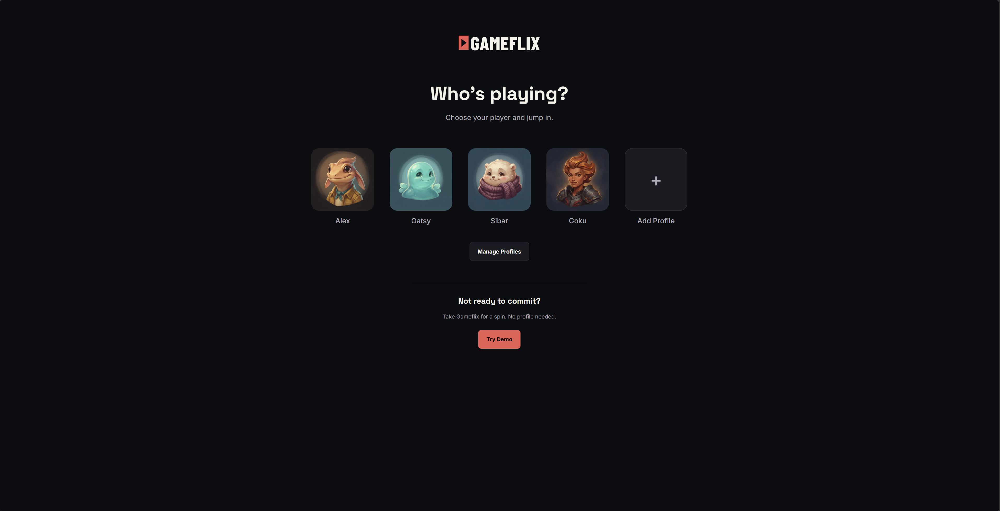

<p align="center">
  
</p>

<p align="center">
  <a href="https://gameflix-snowy.vercel.app/">Live demo</a> ·
  <a href="https://github.com/AlexJCodes/gameflix">GitHub repository</a>
</p>



## About Gameflix

Gameflix is a Netflix-inspired game library where you can keep track of what you're playing, what you've finished, and the games that have been sitting on your backlog for way too long.

I built it for the **Questlog assignment** in the JavaScript Frameworks course at **Medieinstitutet**, aiming for **VG** (the highest grade).

The project started in **Figma**. I wanted it to feel more like browsing a streaming service than filling out a database form. From there, I built the app in React and TypeScript, with the Questlog API handling the games.

## What you can do

- **Player profiles:** Create up to five profiles, each with an avatar and its own game library.
- **My Library:** Add, edit, delete, rate and filter games by status.
- **Game details:** See the platform, status, rating and personal notes for a game.
- **Quick Add:** Search a list of games and fill in the basics without typing everything yourself.
- **Try Demo:** Explore a ready-made library with 22 games, no profile setup needed.
- **Gameflix intro:** A short, animated logo sequence when you enter a profile.

## The interesting challenges

### Profiles without a profile API

The Questlog API stores games under a **handle**, but it doesn't offer endpoints for creating or managing player profiles.

I solved that by saving the profiles in **LocalStorage** and giving each profile its own generated API handle. The profile details stay in the browser; the games are saved through the Questlog API. This keeps each player's collection separate without building another backend.

The trade-off? Profiles don't automatically sync between browsers or devices.

### New players should start fresh (but visitors need something to see)

The API can return starter games for a new handle. For Gameflix, I wanted a new player to start with an empty library, so the app checks for and removes **only the known starter games** during profile setup.

That left another problem: an empty library isn't much of a first impression. So I built **Try Demo**, which prepares a separate collection with 22 example games. Visitors can explore the app straight away, and the demo doesn't reset their changes every time they return.

### Quick Add wasn't in the original plan

After adding a few games manually, I realised that typing every title, platform and cover URL gets old pretty quickly.

**Quick Add** grew out of that. You pick a game from a searchable list, the form fills in the basics, and you can still change everything before saving. A small feature, but a useful UX improvement.

## Built with

**React · TypeScript · Vite · React Router · Tailwind CSS · GSAP · Biome**

**Design:** Figma  
**Game data:** [Questlog API](https://questlog-api.vercel.app/docs)  
**Deployment:** Vercel

I tried to keep the project straightforward: pages bring the views together, components handle the UI, custom hooks manage game requests and state, and services deal with profile storage and setup.

### Why custom hooks?

One of the main goals of the assignment was to separate data handling from the interface. These hooks helped me do that:

| Hook              | What it does                                                                        |
| ----------------- | ----------------------------------------------------------------------------------- |
| `useGames`        | Loads the game collection, including loading, errors and retry.                     |
| `useGame`         | Loads a single game for its details or edit page.                                   |
| `useSaveGame`     | Handles creating, updating and deleting games, plus saving and error states.        |
| `useLocalStorage` | Saves the selected Library filter for each profile and restores it after a refresh. |

This means the pages can focus on **what to show**, rather than handling every API request themselves.

## Run locally

You'll need Node.js and npm installed.

```bash
git clone https://github.com/AlexJCodes/gameflix.git
cd gameflix
npm install
npm run dev
```

Useful commands:

```bash
npm run lint   # Check code with Biome
npm run build  # Type-check and build the production app
```

No API key is needed. Gameflix creates an API handle for each profile and uses it to keep that profile's games separate. You don't need to enter a handle manually.

## Project info

- **Developer:** Alexander Johansson · [AlexJCodes](https://github.com/AlexJCodes)
- **School:** Medieinstitutet
- **Course:** JavaScript Frameworks
- **Assignment:** Questlog
- **Target grade:** VG

---

**One question for Sibar:** If the API supports POST requests, why isn't `POST /swish-for-vg` an endpoint? Asking for a friend. 😄
